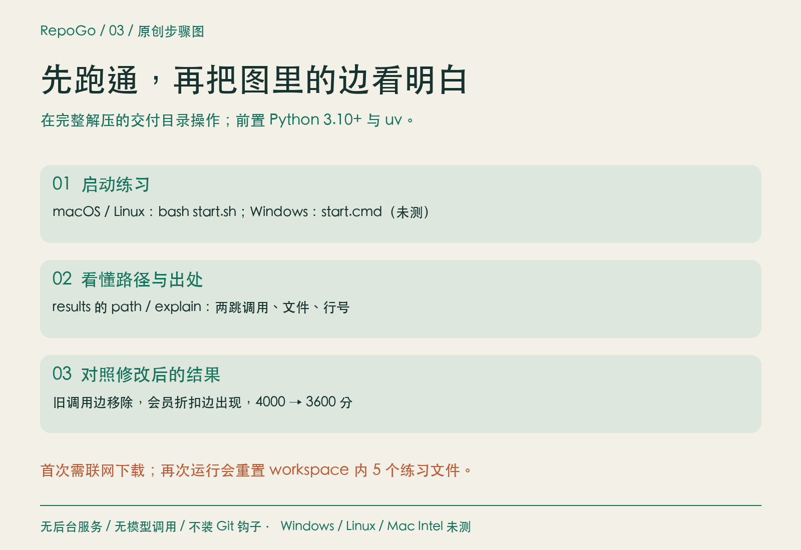

# 从关系图回到代码，再验证一次改动

## 环境与首次运行

固定 Graphify `0.9.97`，源码提交 `0a8cd4e1e342235fe53e881fb5d591bf0460071f`。Python 3.10+、uv；本期使用 macOS Apple Silicon、Python 3.12.14。Linux/macOS 用 Bash 入口；Windows 用 CMD/PowerShell 入口，优先 Python Launcher 的 3.12。Windows/Linux/macOS Intel 没有实际运行证据，不承诺依赖在所有架构都有轮子包。

官方 Python：https://www.python.org/downloads/
官方 uv：https://docs.astral.sh/uv/getting-started/installation/

安装好前置条件后，完整解压，在目录内执行：

```bash
bash start.sh
```

或者用已安装的 Python 3.10+：

```bash
python3 run.py
```

macOS 的 `start.command` 是双击入口，但本期只实测命令行。Windows 可运行 `start.cmd` / `./start.ps1`，执行策略阻拦时停止，不使用 Bypass。Windows ARM64 与 x64 均未测。

入口从 Graphify 官方 GitHub codeload 下载固定提交的源码归档，核对 SHA-256 `5991696931ab1995f412dcd0fbb4b4caa96ac040e32bd8ba3996c8277f35e14f`，再按官方 `uv.lock` 执行 `uv sync --frozen --no-dev`。归档约 13.9 MB，依赖另外下载，实际体积因平台不同。文件一致性校验不等于完整软件安全审计。

源码、虚拟环境、uv 缓存均在本交付目录 `.runtime/` 内；不全局安装 Graphify，不安装助手集成、不执行 `graphify install` / `graphify hook install`。入口设置 `GRAPHIFY_BACKEND=none` 禁止模型后端，设置 `GRAPHIFY_QUERY_LOG_DISABLE=1` 关闭上游查询日志。本期只扫描原创代码；不使用文档/PDF/图片的模型提取能力，不需 API Key、GPU、Docker 或管理员权限。首次联网安装仍有网络和磁盘需求；没有验证断网首次安装。

## 看懂五个文件

`samples/before/` 是原创起点：

- `app.py`：发起一笔演示订单，数量 2、单价 2000 分。
- `checkout.py`：`place_order` 先调用 `quote_total` 算价，再调用 `save_order` 返回结果。
- `pricing.py`：调用标准折扣规则，原价 4000 分。
- `policy.py`：标准折扣 0%，会员折扣 10%。
- `storage.py`：返回字典，不写数据库、不联网，没有真实交易。

`samples/after-pricing.py` 只把算价文件中的导入和调用改为会员折扣。入口先复制 before 五文件到 `.runtime/workspace/`，运行并建图；再用 after-pricing 替换同一目录的 `pricing.py`，重新运行和建图。它确实修改了临时样例副本，不改 `samples/` 原件，不接触你的业务项目。

## 三个上游查询，各回答一个问题

所有命令在交付目录执行。macOS/Linux 程序路径如下（Windows 将 `.venv/bin/graphify` 换成 `.venv/Scripts/graphify.exe`，可用 PowerShell 的 `$env:GRAPHIFY_BACKEND='none'` 与 `$env:GRAPHIFY_QUERY_LOG_DISABLE='1'` 设置同样环境变量）：

```bash
export GRAPHIFY_BACKEND=none
export GRAPHIFY_QUERY_LOG_DISABLE=1
```

“下单怎样走到会员折扣？”查看有方向的调用路线：

```bash
.runtime/graphify-0a8cd4e1e342235fe53e881fb5d591bf0460071f/.venv/bin/graphify path place_order member_discount --graph .runtime/results/after-graph.json
```

预期：`place_order() --calls [EXTRACTED]--> quote_total() --calls [EXTRACTED]--> member_discount()`。`calls` 表示调用；`EXTRACTED` 是工具给出的“从源码提取”标签，不是正确率保证。不要把导入边或无方向连通路线直接理解成运行顺序。

“这条关系来自哪里？”展开算价函数的邻居与出处：

```bash
.runtime/graphify-0a8cd4e1e342235fe53e881fb5d591bf0460071f/.venv/bin/graphify explain quote_total --all --graph .runtime/results/after-graph.json
```

预期函数定义在 `pricing.py L4`，被 `place_order()` 调用的出处为 `checkout.py:L6`，调用 `member_discount()` 的出处为 `pricing.py:L6`。这些行号对应附带样例，改行后要重建，不把旧图当现状。

“以算价为起点，还有哪些关系？”做有限范围的图遍历：

```bash
.runtime/graphify-0a8cd4e1e342235fe53e881fb5d591bf0460071f/.venv/bin/graphify query "quote_total discount" --seed quote_total --graph .runtime/results/after-graph.json
```

这次使用的是官方 CLI 的关键词/种子节点查询，不是模型用中文自动回答业务问题。`--seed` 指明从哪个节点出发，减少同名词带来的无关结果。遇同名歧义，官方命令返回 3 并列候选；找不到节点返回 4，不能把这两种情况当运行通过。

## 怎样确认重建真的生效



本期入口核对同一组真实证据：

1. before 应有 `checkout_place_order → pricing_quote_total → policy_standard_discount` 两条调用边，指向指定文件第 6 行。
2. after 应有第二跳 `policy_member_discount`；旧的 `quote_total → standard_discount` 调用边必须不存在。旧函数仍被定义，不要求节点消失。
3. 官方 `path` / `query` / `explain` 都应返回 0、包含当前折扣函数；入口再核对样例执行金额 4000/3600 分。

节点数和边数可以完全一样，这不能代替上面的检查。输出在 `.runtime/results/`：`before/after-graph.json`、两阶段 `path/query/explain.txt` 和 `summary.json`。`graph.json` 里 `nodes` 是函数/文件等对象，`links` 是关系；关系还带 `relation/source_file/source_location/confidence`。

想自行改样例，先复制 `.runtime/workspace/` 到自己选定的另一个练习目录。在新目录中用同一官方 CLI 执行 `extract 新目录 --code-only --force --no-dedup --max-workers 2`，再查询新目录的 `graphify-out/graph.json`。`--no-dedup` 避免本练习按近似名称合并对象；本期没有评估大项目关闭去重的效果。`--force` 本次仍可使用未变文件的 AST 缓存，日志会说明；本期已检查改动文件确实更新。

## 停止、重跑、升级与隐私

执行中 Ctrl+C；任务结束自动退出，无端口、无后台进程。不要同时开多个入口写同一报告。再次启动会覆盖 `.runtime/workspace/` 中五个练习文件与 `.runtime/results/` 同名结果；自改代码和待留存报告先备份到其他目录。

要完整重置，先把 `.runtime/` 移到别处备份再运行，重新下载与安装。升级应另建目录，重核提交、许可、归档哈希与锁文件，并重跑核心验收，不只改版本号。

真实仓库可能带私人路径、函数名与业务关系；报告先脱敏再分享。本期下载上游与依赖有联网，代码解析/查询选择本地无模型路径。没有使用 Cloud、数据库后端、MCP、所有语言解析或完整语义理解测试。静态调用图无法替代测试对运行行为的验证，动态导入/反射等情况也未在本期验证。
