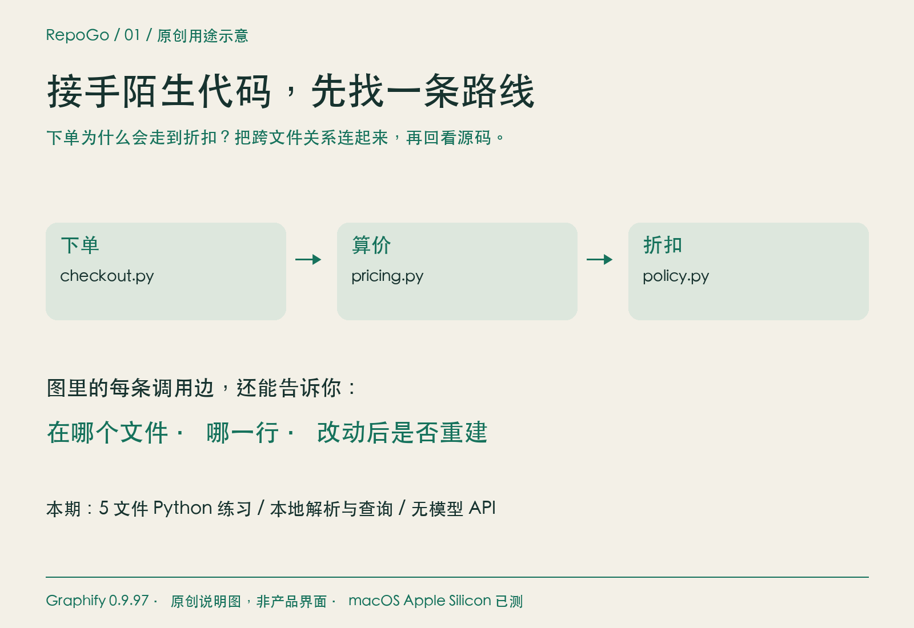
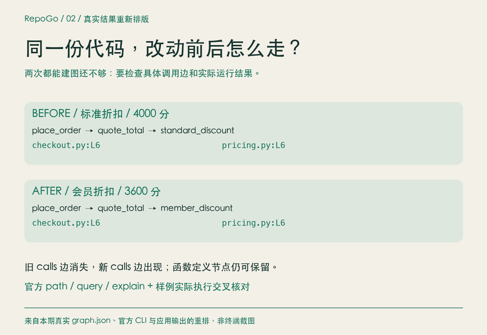

# 接手陌生代码，先找到一条看得懂的路线

Graphify 能把代码文件里的函数、导入和调用整理成可查询的关系图。你可以问“下单函数怎样走到折扣规则”，沿边找到中间函数，再用文件名、行号回看原代码。本期使用官方本地代码解析路径，不需要模型账号；不是完整界面汉化，也不包含 Graphify Cloud。



本期原创练习有五个 Python 文件：入口、下单、算价、折扣、保存结果。实际验证了 `place_order → quote_total → standard_discount` 两跳调用；把算价文件改成会员折扣并重建后，第二跳变成 `member_discount`，旧调用边移除。官方查询还能回指 `checkout.py:L6` 和 `pricing.py:L6`。应用金额由 4000 分变 3600 分，用真实执行交叉核对静态关系。

## 开始

先安装 Python 3.10+（本期实测 3.12）和官方 uv，然后完整解压附件：

```bash
bash start.sh
```

Windows 的 `start.cmd` 或 `start.ps1` 优先调用 `py -3.12`，没有 Python Launcher 时调用 `python`。只有较旧 Python Launcher、没有 3.12 时请安装 3.12，或在已安装的 Python 3.10+ 中直接运行 `python run.py`。不改执行策略。

已实测 macOS Apple Silicon / Python 3.12.14；macOS Intel、Windows、Linux 仅整理入口，未实测。首次下载固定提交源码和依赖需要网络、磁盘空间；无 GPU、Docker、模型服务或 API 费用要求，电脑与网络仍有使用成本。

成功时看到“练习通过：改动前后调用边已更新，应用结果 4000 → 3600 分”。报告在 `.runtime/results/summary.json`；两次官方路径、查询和解释分别保存为文本。运行结束自动退出，无端口或后台服务。



继续阅读 [DEPLOY.md](DEPLOY.md) 学会手动查询、修改和重建；异常见 [FAQ.md](FAQ.md)。每次启动会将 `.runtime/workspace/` 内这五个练习文件恢复为附带样例，再完成对照。自己的修改先复制到其他目录；不要把真实业务项目放进该练习目录。

上游：https://github.com/Graphify-Labs/graphify

RepoGo 原创交付仓库（星球首发前保持私有）：https://gitee.com/lushengjie/repogo-graphify 。附件可独立使用，发布后会按运营流程公开并核验仓库。

RepoGo 提供中文说明、练习样例、重复运行与核验入口、步骤图；没有重写上游解析器。查询由上游 CLI 执行，原创入口只编排练习与核对结果。静态调用关系不等于完整理解所有运行分支，复杂项目仍需结合原代码与测试。
